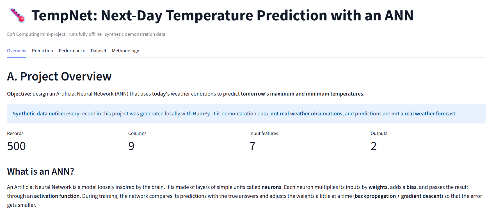
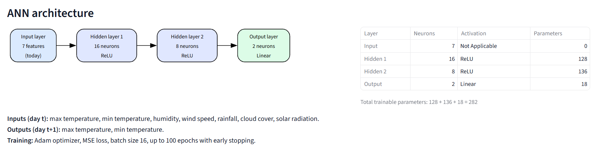
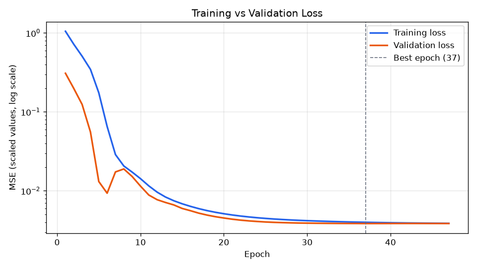
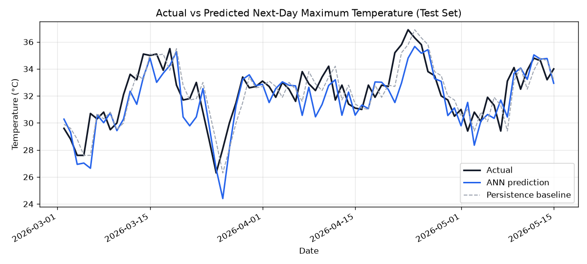
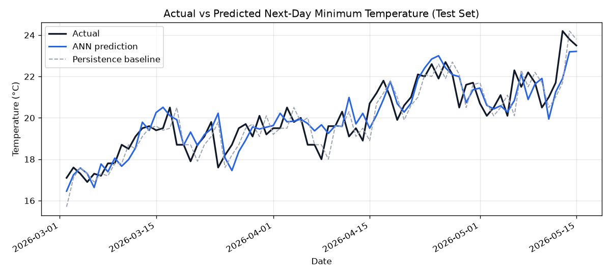

# TempNet: ANN-Based Next-Day Temperature Prediction

A Soft Computing mini-project that trains an **Artificial Neural Network (ANN)** to predict
**tomorrow's maximum and minimum temperatures** from **today's** weather conditions.

> **Synthetic data notice:** all weather data in this project is generated locally with NumPy.
> It is **demonstration data, not real weather observations**, and the predictions are **not a real weather forecast**.

Everything runs offline on your computer. No weather APIs, internet data, databases or cloud services are used.

## TempNet previews

The dashboard preview illustrates the Overview tab and ANN architecture. The charts below are generated by the evaluation pipeline.

<p align="center">
  
</p>
<p align="center">
  
</p>
<p align="center"><em>Dashboard preview — synthetic demonstration data, not a real weather forecast.</em></p>

<p align="center">
  
</p>
<p align="center"><em>Training and validation loss (scaled MSE, log scale).</em></p>

<p align="center">
  
  
</p>
<p align="center"><em>Actual and predicted next-day temperatures compared with the persistence baseline.</em></p>

---

## 1. Project structure

```text
TempNet/
├── app.py                      # Streamlit dashboard
├── requirements.txt
├── README.md
├── .gitignore
├── .streamlit/config.toml      # light theme for the dashboard
├── assets/
│   └── tempnet-dashboard.svg   # Dashboard preview illustration
├── data/
│   ├── weather_data.csv        # synthetic dataset (500 days, 9 columns)
│   └── processed/
│       └── weather_processed.csv
├── models/
│   ├── temperature_ann.keras   # trained ANN
│   ├── input_scaler.pkl
│   └── target_scaler.pkl
├── results/
│   ├── metrics.json
│   ├── test_predictions.csv
│   ├── training_history.csv
│   ├── loss_curve.png
│   ├── max_temperature.png
│   └── min_temperature.png
└── src/
    ├── __init__.py             # shared paths, feature names, random seed
    ├── generate_dataset.py
    ├── preprocess.py
    ├── train.py
    └── evaluate.py
```

## 2. How to run (Windows PowerShell)

TensorFlow needs **Python 3.10 – 3.12** (it has no stable release for Python 3.14 yet).
All commands are run from the project root folder.

```powershell
# 1. Create and activate a virtual environment with Python 3.12
py -3.12 -m venv .venv
.\.venv\Scripts\Activate.ps1

# 2. Install the dependencies
pip install -r requirements.txt

# 3. Generate the synthetic CSV dataset
python -m src.generate_dataset

# 4. Prepare training, validation and test data (and fit scalers)
python -m src.preprocess

# 5. Train and save the ANN
python -m src.train

# 6. Evaluate the model and generate graphs
python -m src.evaluate

# 7. Launch the dashboard (opens http://localhost:8501)
streamlit run app.py
```

If PowerShell blocks `Activate.ps1`, run this once and try again:
`Set-ExecutionPolicy -Scope CurrentUser RemoteSigned`

Every script creates the folders it needs. The dashboard loads the saved model and scalers; it never retrains.

## 3. Dataset

`data/weather_data.csv`: 500 consecutive days (2025-01-01 to 2026-05-15), fixed seed `42`.

| Column | Unit | How it is generated |
|---|---|---|
| `date` | YYYY-MM-DD | Continuous daily range |
| `max_temperature` | °C | Seasonal sine curve + 65% of yesterday's anomaly + sunshine warming − cloud/rain cooling + noise |
| `min_temperature` | °C | Seasonal curve + 50% of yesterday's anomaly + today's max anomaly + small cloud warming + noise; kept ≥ 2 °C below max |
| `humidity` | % | Rises with cloud cover, rain and the wet season; clipped to 0–100 |
| `wind_speed` | km/h | Gamma-distributed breeze, a little stronger on rainy days |
| `rainfall` | mm | Falls on some days only; probability rises steeply above ~65% cloud |
| `cloud_cover` | % | Day-to-day persistent (AR-1) process, cloudier in the wet season; clipped to 0–100 |
| `solar_radiation` | W/m² | Seasonal clear-sky value reduced by up to 60% by cloud cover |
| `day` | integer | Sequential day number 1–500 (identifier only, **not** an ANN input) |

## 4. Methodology

**Synthetic CSV generation → Data preprocessing → ANN training → Next-day prediction → Evaluation**

1. **Generation:** `generate_dataset.py` builds the dataset and checks every rule (no gaps, no duplicates, max > min, valid ranges).
2. **Preprocessing:** `preprocess.py` pairs each day *t* with day *t+1*'s temperatures by shifting the temperature columns up one row. The last row has no "tomorrow", so it is dropped (499 samples). The samples are split **in date order** with no shuffling:

   | Split | Rows | Dates |
   |---|---|---|
   | Train (70%) | 349 | 2025-01-01 → 2025-12-15 |
   | Validation (15%) | 75 | 2025-12-16 → 2026-02-28 |
   | Test (15%) | 75 | 2026-03-01 → 2026-05-14 |

   MinMax scalers for the inputs and targets are fitted on the **training rows only**, so no information from the validation or test periods leaks into training.
3. **Training:** `train.py` trains the ANN with Adam, MSE loss, batch size 16 and up to 100 epochs. Early stopping (patience 10) watches validation loss and restores the best weights.
4. **Evaluation:** `evaluate.py` converts predictions back to °C, computes MAE and RMSE, and compares them with a **persistence baseline** (tomorrow = today).

## 5. ANN architecture

| Layer | Neurons | Activation | Parameters |
|---|---|---|---|
| Input | 7 | – | 0 |
| Hidden 1 | 16 | ReLU | 7×16 + 16 = 128 |
| Hidden 2 | 8 | ReLU | 16×8 + 8 = 136 |
| Output | 2 | Linear | 8×2 + 2 = 18 |
| **Total** | | | **282** |

- **Inputs (day t):** max temperature, min temperature, humidity, wind speed, rainfall, cloud cover, solar radiation
- **Outputs (day t+1):** max temperature, min temperature (predicted together by one network)
- **ReLU** in the hidden layers lets the network learn non-linear patterns. A **linear** output is used because temperature is a continuous value (regression), not a class.

## 6. Sample results (test set, 75 days)

| Target | Model | MAE (°C) | RMSE (°C) |
|---|---|---|---|
| Max temperature | **ANN** | 1.234 | 1.554 |
| Max temperature | Persistence baseline | **1.140** | **1.383** |
| Min temperature | **ANN** | **0.671** | **0.858** |
| Min temperature | Persistence baseline | 0.709 | 0.885 |

**What this means:**
- The ANN's next-day predictions are off by about **1.2 °C (max)** and **0.7 °C (min)** on average.
- The persistence baseline performs better for maximum temperature. The ANN improves on the baseline for minimum temperature (about 5% lower MAE).
- The margin is small because the synthetic weather has a lot of day-to-day persistence and random noise that no model can predict. "Tomorrow = today" is already a strong rule in that situation.
- The ANN never predicted a maximum less than or equal to the minimum on the test set.
- Early stopping finished training after 47 epochs and restored the best weights from epoch 37.

Exact numbers are in `results/metrics.json`. They should match the table above for the checked-in results; TensorFlow can give slightly different results when the pipeline is rerun on other hardware or versions.

## 7. Dashboard sections

| Tab | Contents |
|---|---|
| Overview | Objective, ANN explained simply, dataset size, architecture diagram, synthetic-data notice |
| Prediction | Form for the 7 inputs with range validation → predicted max/min for tomorrow (°C, 2 decimals). It warns if the predicted max ≤ min, or if inputs fall outside the training range |
| Performance | MAE/RMSE vs baseline, MAE/RMSE/MSE explained, loss and prediction graphs |
| Dataset | First rows, shape, columns, date range, temperature and weather charts |
| Methodology | The 5-step workflow |

## 8. Conclusion

TempNet shows the full Soft Computing workflow on a small, reproducible problem. It generates a synthetic dataset with realistic structure, prepares it without data leakage, trains a compact 7-16-8-2 feedforward ANN, and evaluates it honestly against a simple baseline. The ANN predicts next-day maximum and minimum temperatures with MAE of about 1.2 °C and 0.7 °C, respectively. It improves on the persistence baseline for minimum temperature, while the baseline is stronger for maximum temperature. This shows that, for strongly persistent signals like temperature, beating a naive baseline by a wide margin is hard.
